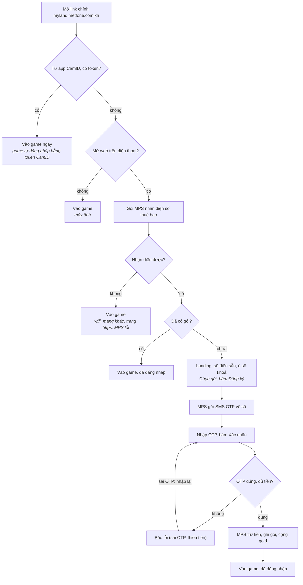

<!--
Bản chép nguyên văn từ tài liệu Claude Docs "Nghiệm thu luồng đăng ký gói MyLand trên landing"
(1 tab — "Tab 1"), tác giả @Quangnh, ngày tài liệu 20-10-2026.
Chép lại ngày 22-10-2026 bằng cách đọc trang hiển thị (artifact không cho tải file).
Sơ đồ luồng gốc là hình vẽ — chuyển sang Mermaid, giữ nguyên chữ trên từng ô và nhãn mũi tên.
-->

# Nghiệm thu luồng đăng ký gói MyLand trên landing

20-10-2026 · @Quangnh

## Thông tin chung

Người dùng mở link chính trên điện thoại 4G Metfone, hệ thống tự nhận diện số và cho đăng ký gói MyLand bằng OTP; không nhận diện được thì vào thẳng game.

| Mục | Nội dung |
|---|---|
| Link chạy chính thức | `http://myland.metfone.com.kh/` |
| Phiên bản | `20261020-1026-f929127-local` (file `VERSION` trên server) |
| Gói cước | Ngày 15 cents (NGAY) · Tuần 50 cents (TUAN) · Tháng 1,5 USD (THANG) |
| Nhận diện số | MPS Metfone `mobile.html`, gọi từ trình duyệt điện thoại |
| Đăng ký, trừ tiền | API `registerPackage` (Java farm-business) gọi MPS `otp.html` |
| Log đối soát | Bảng `LANDING_REGISTER_LOG`, DB `game_farm` |

Phạm vi nghiệm thu: luồng vào link chính, nhận diện số, đăng ký bằng OTP, vào game sau đăng ký và log trong DB. Luồng mua vật phẩm trong game không thuộc phạm vi này.

## Luồng xử lý

Vào từ app CamID (link có token) thì vào game ngay, game tự đăng nhập bằng token. Chỉ người mở link trên web bằng điện thoại mới vào luồng landing; máy tính vào thẳng game. Trong luồng landing, không nhận diện được số hoặc số đã có gói thì cũng vào game. Chỉ số MPS nhận diện được và chưa có gói mới thấy form đăng ký.

**Chỉ số MPS nhận diện được mới đăng ký, còn lại vào game**



Người dùng không nhập được số khác: ô số bị khoá và server từ chối mọi số khác số MPS nhận diện. Thiếu tiền thì về landing để đăng ký lại sau khi nạp tiền.

## Kịch bản nghiệm thu

Test trên điện thoại dùng Chrome thường (không ẩn danh), mở link bằng `http://`. Cột Kết quả do người test chọn.

| # | Điều kiện | Thao tác | Kết quả mong đợi | Kết quả |
|---|---|---|---|---|
| 1 | 4G Metfone, số chưa đăng ký | Mở link chính | Landing hiện số điền sẵn, ô số không sửa được | Chưa test |
| 2 | Tiếp #1 | Chọn gói, bấm Đăng ký | Nhận SMS OTP, hiện ô nhập OTP | Chưa test |
| 3 | Tiếp #2 | Nhập sai OTP | Báo OTP sai, cho nhập lại, không trừ tiền | Chưa test |
| 4 | Tiếp #2 | Nhập đúng OTP | Báo đăng ký thành công, sau 3 giây vào game đã đăng nhập; tài khoản bị trừ đúng giá gói; gold/diamond được cộng 1 lần | Chưa test |
| 5 | Số vừa đăng ký ở #4 | Mở lại link chính | Vào thẳng game, đã đăng nhập | Chưa test |
| 6 | 4G Metfone, tài khoản không đủ tiền | Đăng ký, nhập đúng OTP | Báo không đủ tiền, không trừ tiền | Chưa test |
| 7 | Điện thoại dùng wifi / mạng khác | Mở link chính | Vào thẳng game, không hiện form đăng ký | Chưa test |
| 8 | Máy tính | Mở link chính | Vào thẳng game | Chưa test |
| 9 | 4G Metfone, số chưa đăng ký | Bấm xin OTP 4 lần trong 10 phút | Lần 4 báo đã xin OTP quá nhiều lần | Chưa test |
| 10 | Sau mỗi kịch bản trên | Kiểm tra bảng `LANDING_REGISTER_LOG` | Có đủ dòng `OTP` / `REGISTER` đúng số, gói, kết quả | Chưa test |

## Log tra soát / đối soát

Mỗi lần người dùng bấm Đăng ký hoặc Xác nhận OTP được ghi 1 dòng vào bảng `LANDING_REGISTER_LOG` (DB `game_farm`). Hai bước dùng chung 1 API nên phân biệt bằng cột `step`.

| Cột | Ý nghĩa |
|---|---|
| `step` | `OTP` = xin mã OTP, chưa trừ tiền · `REGISTER` = xác nhận OTP, MPS trừ tiền |
| `status` | `otp_sent`, `success`, `success_after_timeout`, `wrong_otp`, `otp_expired`, `no_balance`, `already_subscribed`, `failed`, `timeout`, `blocked`, `limited` |
| `req_id` | Mã giao dịch, giống nhau ở 2 bước; trùng `cpRequestId` trong `VP_BILLING_ACTIVITY` |
| `msisdn`, `package`, `price` | Số đăng ký, gói, giá theo đơn vị MPS (150000 = 15 cents) |
| `error_code`, `result_text` | Mã API trả về và diễn giải |
| `api_url`, `api_response`, `duration_ms` | URL đã gọi (OTP che `***`), nguyên phản hồi, thời gian gọi |
| `order_result`, `partner_notify`, `jwt_issued` | Kết quả cập nhật đơn, báo đối tác truyền thông, có vào game đã đăng nhập không |
| `utm_source`, `click_id`, `ip`, `user_agent` | Nguồn quảng cáo và thiết bị |

Lần bấm gần nhất:

```sql
SELECT id, created_at, step, status, error_code, msisdn, package, req_id, result_text
FROM LANDING_REGISTER_LOG ORDER BY id DESC LIMIT 20;
```

Đăng ký thành công trong ngày (đã trừ tiền):

```sql
SELECT created_at, msisdn, package, amount_label, price, req_id, utm_source, partner_notify
FROM LANDING_REGISTER_LOG
WHERE step = 'REGISTER' AND status IN ('success', 'success_after_timeout')
  AND created_at >= '2026-10-20' AND created_at < '2026-10-21'
ORDER BY id;
```

Đối chiếu với lịch sử trừ tiền của Java. Java ghi 1 dòng cho mỗi lần gọi MPS cùng `cpRequestId` (lần gửi OTP + từng lần xác nhận), dòng cuối là lần xác nhận:

```sql
SELECT l.created_at, l.msisdn, l.package, l.req_id, l.status, l.error_code,
       GROUP_CONCAT(CONCAT(b.billing_at, ' RES=', b.error_code, ' amount=', b.amount)
                    ORDER BY b.billing_at SEPARATOR ' | ') AS java_billing
FROM LANDING_REGISTER_LOG l
LEFT JOIN VP_BILLING_ACTIVITY b ON b.cpRequestId = l.req_id
WHERE l.step = 'REGISTER' AND l.api_called = 1 AND l.created_at >= '2026-10-20'
GROUP BY l.id ORDER BY l.id;
```

## Giới hạn đã biết

- **Chỉ nhận diện được trên 4G Metfone.** Wifi hoặc mạng khác thì MPS không trả số, người dùng vào thẳng game.
- **Trang https không nhận diện được.** MPS chỉ có http, trình duyệt chặn trang https gọi sang http. Hệ thống tự chuyển trang https về http; Chrome ẩn danh vẫn có thể giữ https, khi đó người dùng vào thẳng game.
- **Thời gian chờ nhận diện tối đa 120 giây** (`detect_timeout`). MPS không trả lời thì người dùng nhìn màn hình chờ tới lúc đó rồi mới vào game.
- **Không cho nhập số tay.** Chỉ số MPS nhận diện được mới được đăng ký; server từ chối số khác (`status = blocked` trong log).
- **Mã "đã gửi OTP" của MPS** đang nhận `0` hoặc `100`, cần xác nhận qua lần test thật đầu tiên (cột `error_code` dòng `step = OTP`).
- Hai câu thông báo (xin OTP quá nhiều lần, hết phiên OTP) đang là tiếng Anh, chưa dịch sang Khmer.

## Phụ lục: triển khai và cấu hình

Các bước làm 1 lần trên server trước khi nghiệm thu.

1. Tạo bảng log (DB `game_farm`), file `sql/landing_register_log.sql`, kiểm tra bằng `DESCRIBE LANDING_REGISTER_LOG;` (30 cột).
2. Upload `landing-golive-20261020.zip` vào `/webroot/mylandkh.com/current/` rồi chạy:

   ```bash
   cd /webroot/mylandkh.com/current
   unzip -o landing-golive-20261020.zip
   cat VERSION        # 20261020-1026-f929127-local
   rm landing-golive-20261020.zip
   ```

3. Kiểm tra server gọi được API Java (`000` = không kết nối được) và trang `/admin` đã đóng (`404`):

   ```bash
   curl -m 5 -s -o /dev/null -w '%{http_code}\n' http://192.168.234.53:8099/
   curl -s -o /dev/null -w '%{http_code}\n' http://myland.metfone.com.kh/admin
   ```

4. Theo dõi log chi tiết trong lúc test (cần `$CONFIG['debug_log'] = true;` trong `includes/config.local.php`):

   ```bash
   tail -f /webroot/mylandkh.com/logs/landing-debug-$(date +%F).log | grep --line-buffered -E '"step":"(https_to_http|detect_call|detect_result|api_otp|api_register|register_log)"'
   ```

Cấu hình trong `services/myland/config.php`:

| Khoá | Giá trị | Ý nghĩa |
|---|---|---|
| `mps.detect_enabled` | `true` | Nhận diện cho mọi lượt vào trên điện thoại (`'test'` = chỉ phiên đã mở `/?mps_test=1`) |
| `mps.detect_timeout` | `120` | Giây chờ MPS tối đa |
| `otp_enabled` | `true` | Đăng ký bằng OTP qua API `registerPackage` |
| `otp.detected_only` | `true` | Chỉ số nhận diện được mới đăng ký; `false` = cho nhập số tay |
| `otp.max_send` | `3` | Số lần xin OTP tối đa / 10 phút / phiên |
| `apis.otp` | `http://192.168.234.53:8099/service/json/registerPackage` | API đăng ký (Java farm-business) |

Quay lại bản trước: sao lưu ở `/webroot/mylandkh.com/backup-truoc-otp-*.tgz`, giải nén đè vào `current/`.
